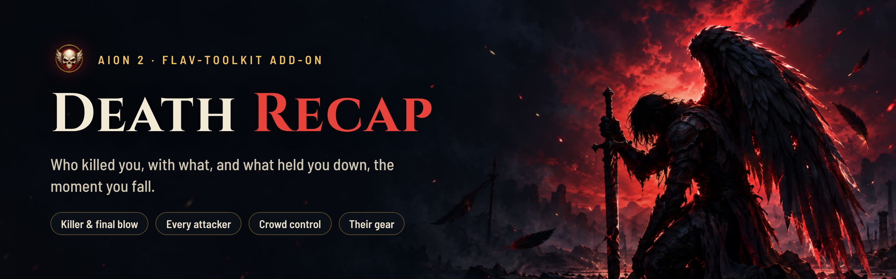
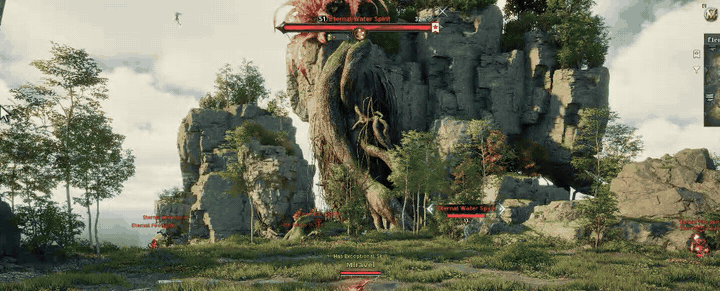
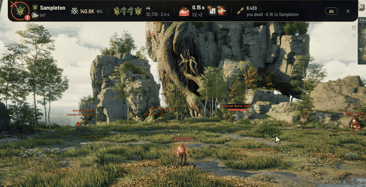
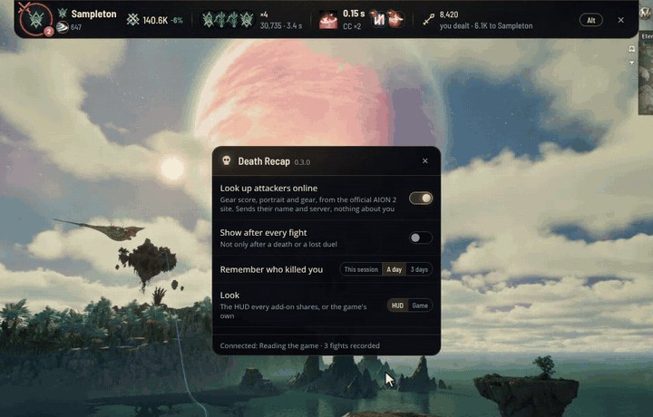
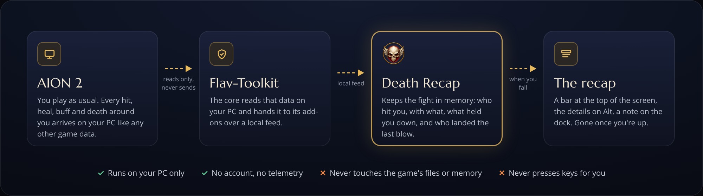

<p align="center">
  
</p>

<p align="center">
  <a href="../../releases/latest"></a>
  
  <a href="https://github.com/Flavbestlol/flav-toolkit"></a>
  
  <a href="https://ko-fi.com/flavbest"></a>
</p>

<p align="center">
  <b>Stop wondering what just happened.</b><br>
  The moment you die in AION 2: who killed you, with what, who else was on you, and what kept you from acting.
</p>

---

> [!WARNING]
> **This is a fully vibe-coded side project.** It was built for fun, to make dying a little more instructive. Expect bugs and rough edges. It's free, it's open, and it comes with no promises. If something breaks, [open an issue](../../issues), or better, fix it and send a pull request.

## Contents

- [What it does](#what-it-does)
- [How it works](#how-it-works)
- [Install](#install)
- [Is it safe?](#is-it-safe)
- [Troubleshooting](#troubleshooting)
- [Build it yourself](#build-it-yourself)
- [Credits](#credits)
- [Support](#support)

## What it does

Death Recap is an add-on of **[Flav-Toolkit](https://github.com/Flavbestlol/flav-toolkit)**: the core reads the game, Death Recap reads the core's local feed and shows you what killed you.

### The moment you fall

<p align="center">
  
</p>

- **A bar at the top of the screen** opens when you die: the killer (portrait or class emblem), the final blow, their combat power and gear score against yours.
- **Everyone who hit you**, how long you could not act and why, and what you dealt back.
- **It goes away by itself** when you're back on your feet.

### Every attacker, at a glance

<p align="center">
  
</p>

- **Hold <kbd>Alt</kbd>** (or click the bar to keep it open) for one line per attacker: when they joined, their damage and crits, and their skills with the game's own icons.
- **What controlled you**: the ability (skill, passive or Theostone), what it did, how many times and for how long.
- **Who hunts you**: a red number on a player who killed you before, this death included. Hover it for when and with what. Kept for this session, 24 hours or 3 days, your choice.
- **Monsters and bosses** get a drawn mark and a *Monster* or *Boss* tag.

### Who they are, what they wear

<p align="center">
  
</p>

- **Online lookups** are **off** until you turn them on. Then each attacker's gear score, official portrait and gear come from the official AION 2 site.
- **The killer first**, then whoever opened the fight, then the rest. When the site is busy, they come a little later instead of not at all.
- **Hover a portrait** for their gear: the enchant level, and the diamond level past +15. Click a name for their character page.

### Two looks, one hub

<p align="center">
  
</p>

- **The HUD** every Flav-Toolkit add-on shares (the default), or **the game's own look**.
- **On the dock**: a death lights up Death Recap's skull with a note, *Killed by Sampleton · 140.6K CP*, and the killer's class emblem. It's taken back when you're up again.
- **From the hub**: **Open** shows the last recap, **Settings** opens these settings: online lookups, a recap after every fight (not only a death or a lost duel), how long to remember who killed you.

## How it works

<p align="center">
  
</p>

1. **Flav-Toolkit** reads what the game already sends to your PC: every hit, heal, buff and death around you, with the skills' names and icons. It never sends anything to the game.
2. It hands that to its add-ons over a local feed. **Death Recap** keeps the last fight in memory: who hit you, with what, when, what controlled you and who landed the last blow.
3. When you fall, **the recap** opens at the top of the screen, and a note lights up Death Recap's skull on Flav-Toolkit's dock. Flav-Toolkit's hub starts and stops Death Recap for you.

Only if you turn on online lookups does it ask the official AION 2 site for an attacker's gear score, portrait and gear.

## Install

You need **Windows 10 or 11** (64-bit), **AION 2** in Borderless or Windowed mode, and **[Flav-Toolkit](https://github.com/Flavbestlol/flav-toolkit)** running. Death Recap reads the game through it; without it, Death Recap waits.

1. Download **`death-recap-<version>.zip`** from the [latest release](../../releases/latest).
2. Extract it into its own folder inside one of the folders Flav-Toolkit's hub looks in for add-ons, for example `Addons\Death Recap\`. The folder holds `death-recap.exe`, `addon.json` and `emblem.png`.
3. In the hub, **Death Recap** appears in the list. Click **Start**.

> [!NOTE]
> The first release is on its way. Until it's out, you can [build it yourself](#build-it-yourself).

## Is it safe?

Here is exactly what it does:

- **It only reads.** It reads Flav-Toolkit's local feed. It never reads the game's memory or files, and sends nothing to the game.
- **It asks Windows two things about the game's window**: whether the game runs as administrator (then <kbd>Alt</kbd> can't be read, and the bar says to click instead), and, when you close the settings with × or Esc, to hand the game its focus back.
- **Nothing about you leaves your PC.** No telemetry. Its settings, and the history of who killed you (only when you keep it for a day or 3 days), stay in `%APPDATA%\com.flavbest.death-recap\`. Windows' web view keeps its usual cache (the icons and portraits it showed) in `%LOCALAPPDATA%\com.flavbest.death-recap\`.
- **The network**: the game's icons and font from the game's own servers. Only while online lookups are on, the official AION 2 site, with an attacker's name and server, then the site's own id for them. Nothing about you. Turning lookups off stops them at once. Every host is listed in [`addon.json`](addon.json), and the hub shows them.
- **It's open.** All the code is in this repository: read it, or build it yourself.

> [!NOTE]
> This is a third-party fan project, not made or supported by NCSOFT. Use it at your own risk.

## Troubleshooting

<details>
<summary><b>Nothing shows when I die</b></summary>

Check in Flav-Toolkit's hub that the game is being read and that Death Recap is running. Death Recap opens on a death or a lost duel; for every fight, turn on **Show after every fight** in its settings.
</details>

<details>
<summary><b><kbd>Alt</kbd> does nothing</b></summary>

The game runs as administrator, and Windows hides the keyboard from programs that don't. Click the bar instead, or use **Restart as administrator** in Flav-Toolkit's hub or tray.
</details>

<details>
<summary><b>No portraits, gear score or gear</b></summary>

Online lookups are off by default: turn them on in Death Recap's settings. When the official site is busy, they come in a little later.
</details>

<details>
<summary><b>My antivirus flags it, or Windows says "Windows protected your PC"</b></summary>

It's new and not code-signed. Download it only from this page's [Releases](../../releases/latest), never from a re-upload. If your antivirus still blocks it, please [open an issue](../../issues) with its name and the detection name.
</details>

<details>
<summary><b>Something else is wrong</b></summary>

[Open an issue](../../issues) with what you did, what you expected and what happened. A screenshot helps. Please blur other players' names and chat.
</details>

## Build it yourself

```bash
python tools/class_icons.py              # once per clone: the class emblems (fetched, not committed)
cargo fmt --all && cargo clippy --workspace --all-targets -- -D warnings && cargo test --workspace
cargo build --release -p death-recap     # Windows: target/release/death-recap.exe
cargo run -p death-recap --example print # no windows: each recap as a line (beside `flav feed <capture>`)
```

The core is pinned by commit in `Cargo.toml` (`flav-events`, `flav-sdk`). How it works: [`docs/DESIGN.md`](docs/DESIGN.md). The GIFs and the banner on this page are made from the real pages with made-up fights, no recording: [`tools/readme-gifs`](tools/readme-gifs).

## Credits

- **[Flav-Toolkit](https://github.com/Flavbestlol/flav-toolkit)**, the core it reads, built on the parser of the **[A2 Tools DPS Meter](https://github.com/taengu/A2Tools-DPS-Meter)** by **taengu**.
- The banner's art and the emblem are original, made for this project.

AION 2 is a trademark of NCSOFT. This project isn't affiliated with NCSOFT.

## Support

Death Recap is free and always will be. If it helped you get better at not dying and you'd like to say thanks, you can buy me a coffee:

<a href="https://ko-fi.com/flavbest"></a>

No pressure: a star on this page or a bug report helps just as much.

## License

[GPL-3.0](LICENSE), like the parser Flav-Toolkit is built on.
